# Proposed Architecture & Revamp Specification: UNIQUE ENGINEERS

**Project:** Unique Engineers Website Revamp  
**Primary Source of Truth for Content & Business Data:** `UNIQUE ENGINEERS - COMPANY PROFILE.pdf` (Latest Official 2026 Edition)  
**Target Application Directory:** `new-website/`  
**Framework:** Next.js 15+ (App Router) + React 19 + TypeScript + Tailwind CSS  
**Design Reference Benchmarks:** Dürr India (`durr-india.com`), Eisenmann Industrial Engineering  
**Implementation Mode:** Active Phased Build  

---

## 1. Up-to-Date Corporate Data (Extracted from 2026 Company Profile PDF)

The legacy website contained stale data dating from 2016-2017. All corporate information is now synchronized with the official **Unique Engineers - Company Profile**:

| Data Dimension | Legacy Website (Outdated) | Official 2026 Profile (Current) |
| :--- | :--- | :--- |
| **Years of Excellence** | 20+ Years | **25+ Years of Engineering Excellence (Since 1999)** |
| **Projects & Shutdowns** | 50+ Projects | **500+ Projects & Shutdowns Delivered** |
| **Major Clients** | 18 unverified logos | **50+ Major Tier-1 Clients & OEMs** |
| **Workforce** | Unspecified | **200+ Skilled Personnel** (ESIC & PF compliant) |
| **Safety Casualties** | "Zero casualties since 1999" | **ZERO Casualties Since Inception (1999)** |
| **Key Leadership / Business Dev** | Unlisted or outdated agency email | **Mr. Murtaza** (Proprietor · Business Development) |
| **Direct Phones / WhatsApp** | +91-22-40036552 (only landline) | **+91 99205 55852** (Mobile/WhatsApp), **+91 88507 98923** (Alt), **022-4003 6552** |
| **Official Contact Email** | `info@uniqueengineers.com` / agency email | **`murtaza@uniqueengineers.com`**, **`info@uniqueengineers.com`** |
| **Works Facility Address** | Gala No. 111 (or Gala 13) | **Priya Complex, Gala-106, Zakat Naka, Bhiwandi – 421 302, Maharashtra** |
| **Registered Office** | 213 Bora Bazar Street, Fort, Mumbai | **1st Floor, 213 Bora Bazar St, Opp Jain Mandir, Near CST, Fort, Mumbai 400001** |
| **Corporate Registrations** | None shown | **GST:** `27ABYPT2014L1Z1`<br/>**ESIC:** `31000584400000599`<br/>**PF:** `MH/125486` |
| **Client Portfolio** | Generic gallery | **Marquee OEMs:** Mahindra, Tata Motors, Toyota, Volvo Eicher, Mercedes-Benz, VW, JCB, John Deere, Royal Enfield, OLA Electric, etc. |
| **EPC Partner Network** | Mentioned in passing | **Eisenmann, Dürr, TEIL, Bullows, Taikisha, Haden, B+M, Leo, Sparkline, GEICO** |

---

## 2. Project Execution Phases

The revamp is organized into structured, progressive development phases:

```
┌────────────────────────────────────────────────────────────────────────┐
│ PHASE 1: Scaffolding, Core Infrastructure & Design System              │
│ ├─ Next.js 15 App Router setup, TypeScript strict, Tailwind config     │
│ ├─ Modern industrial design system (Unique Blue #1F54A3, Slate #0F1E36)│
│ ├─ Fully typed data models (company.ts, services.ts, projects.ts)       │
│ └─ Global Layout: Top utility bar, responsive navbar, megamenu, footer │
└────────────────────────────────────────────────────────────────────────┘
                                    │
                                    ▼
┌────────────────────────────────────────────────────────────────────────┐
│ PHASE 2: Core Presentational Pages & Updated Content                   │
│ ├─ High-impact Homepage: Hero, 25+ yrs stats, 500+ projects, clients   │
│ ├─ About Us (/about): Profile, Mission, Vision, Hallmarks, Compliance  │
│ ├─ Safety & EHS (/safety): Zero casualties, PPE protocols, equipment   │
│ ├─ Workforce & Equipment (/capabilities): 200+ personnel & machinery   │
│ ├─ Client Portfolio (/clients): Tier-1 OEMs & EPC partner grid         │
│ └─ Project Showcase (/projects): 500+ delivered projects categorized   │
└────────────────────────────────────────────────────────────────────────┘
                                    │
                                    ▼
┌────────────────────────────────────────────────────────────────────────┐
│ PHASE 3: Services Architecture (24 Turnkey Disciplines)                │
│ ├─ Categorized Services Index (/services) with Dürr-style panels       │
│ ├─ Dynamic Service Detail Pages (/services/[slug])                     │
│ ├─ Rich visual galleries with accessible lightboxes & technical specs  │
│ └─ High-speed static parameter pre-rendering (generateStaticParams)   │
└────────────────────────────────────────────────────────────────────────┘
                                    │
                                    ▼
┌────────────────────────────────────────────────────────────────────────┐
│ PHASE 4: Interactive Modules, Secure Forms & Conversion                │
│ ├─ Request for Quote (RFQ) & Contact Form (/contact)                   │
│ ├─ Bot mitigation (Turnstile / Honeypot / Zod validation)              │
│ ├─ Transactional email notifications to murtaza@uniqueengineers.com    │
│ ├─ Careers page (/careers) with applicant submission pipeline          │
│ └─ Interactive Google Maps embed & multi-facility location cards       │
└────────────────────────────────────────────────────────────────────────┘
                                    │
                                    ▼
┌────────────────────────────────────────────────────────────────────────┐
│ PHASE 5: SEO, Performance, Compliance & Production Readiness           │
│ ├─ 301 legacy redirects mapping all .asp routes to clean URLs          │
│ ├─ Dynamic XML sitemap, robots.txt, Open Graph images & JSON-LD schema │
│ ├─ WebP image optimization & responsive picture elements               │
│ └─ Multi-target deployment build test (Vercel / VPS / Standalone Node) │
└────────────────────────────────────────────────────────────────────────┘
```

---

## 3. Detailed Information Architecture & Sitemap

```mermaid
flowchart TD
    Home["/ (Home - Hero, Verified Metrics, Featured Services, OEM Logos, CTAs)"]
    
    About["/about (About Us)"]
    About --> Story["/about#overview (25+ Years Legacy Since 1999)"]
    About --> Mission["/about#mission (Mission, Vision, Hallmarks)"]
    About --> Compliance["/about#compliance (GST, ESIC, PF, Banking Details)"]

    Services["/services (Engineering Services)"]
    Services --> PaintShop["Paint Finishing Systems (Booths, Ovens, Tanks, Robots)"]
    Services --> MaterialHandling["Conveyors & Handling (Power & Free, Floor, Drop Lifts)"]
    Services --> HeavyStructures["Structural & Piping (MS Structures, Chimneys, Ducting)"]
    Services --> PlantOps["Plant Operations (Shutdowns, Relocations, Maintenance)"]
    Services --> Individual["/services/[slug] (All 24 Individual Service Deep Dives)"]

    Projects["/projects (Delivered Projects Portfolio - 500+ Track Record)"]
    Projects --> PAutomotive["Automotive Paint Shops (Yamaha, Benz, VW, Volvo, Mahindra)"]
    Projects --> PConveyors["Conveyor Installations (Tata Motors, Toyota, OLA Electric)"]
    Projects --> PShutdowns["Shutdown & Maintenance (New Holland CNH, Fiat, M&M)"]
    Projects --> PPipelines["Industrial Gas & Pipelines (Mukand, Bareli API Spec 5L)"]

    Capabilities["/capabilities (Workforce & Equipment Fleet)"]
    Capabilities --> Workforce["Workforce Strength (200+ Personnel, Certified Welders)"]
    Capabilities --> Equipment["Owned Machinery Inventory (Welding, Lifting, Cutting)"]

    Safety["/safety (EHS Leadership & Zero Casualties Since 1999)"]
    Clients["/clients (50+ Major Tier-1 Clients & Global EPC Partners)"]
    Gallery["/gallery (Categorized High-Resolution Project Photo Portfolio)"]
    Careers["/careers (Job Roles & Candidate Application Portal)"]
    Contact["/contact (Fort Office, Bhiwandi Works, Mr. Murtaza Contact, RFQ Form)"]

    Legal["/privacy-policy & /terms-of-use"]

    Home --> About
    Home --> Services
    Home --> Projects
    Home --> Capabilities
    Home --> Safety
    Home --> Clients
    Home --> Gallery
    Home --> Careers
    Home --> Contact
    Home --> Legal
```



---

## 4. Key Components & Features Spec

1. **Header & Top Utility Bar:**
   - Top Bar: Emergency / Direct WhatsApp `+91 99205 55852`, Office `022-4003 6552`, `murtaza@uniqueengineers.com`, GST/PF verified badges.
   - Main Nav: Logo, Services Mega-Menu, Projects, Capabilities, Safety, Clients, About, Contact, and a prominent "Request Quote" CTA button.
2. **Dynamic Project Case Studies (`/projects`):**
   - Detailed breakdown of 30+ marquee projects from the PDF: Yamaha Chennai, Mercedes-Benz Chakan, Volkswagen Chakan, OLA Electric, Tata Motors, Volvo, John Deere, etc.
3. **Equipment & Workforce Counter Modules:**
   - 200+ Personnel breakdown (Site Managers, Certified Arc/TIG/MIG Welders, Riggers).
   - Owned equipment catalog (Arc/MIG/TIG machines, 40+ grinders, chain pulley blocks up to 5T).
4. **Interactive RFQ & Contact System:**
   - Server-validated inquiry form sending directly to `murtaza@uniqueengineers.com` and `info@uniqueengineers.com`.
   - Invisible spam & bot defense with honeypot + rate limiter.
5. **SEO & High Performance:**
   - Sub-second LCP, zero layout shifts, full OpenGraph/Twitter cards, and rich JSON-LD snippets.
